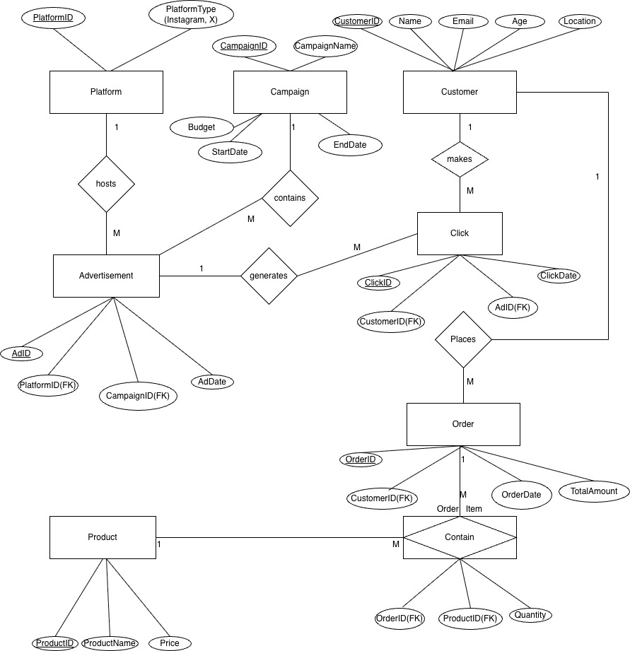

# Retail Marketing Analytics with SQL

**Author: Dipesh Subedi** | MySQL | Database design | Marketing analytics

An individual Macquarie University BUSA8090 case study based on David Jones. The project designs an eight-table relational database and uses seven SQL queries to examine advertising clicks, customer spending, product sales and campaign performance.

**All records are dummy data for a university case study. This is not actual David Jones customer data, company performance or commissioned work.**

## What this project demonstrates

- Designing related tables with primary, foreign and composite keys.
- Resolving an order–product many-to-many relationship using an order-item table.
- Writing joins, aggregations, CASE expressions and a correlated subquery.
- Connecting analytical questions to marketing decisions.
- Checking join duplication and distinguishing metrics that the data can support.

## Useful files to review

| File | Why it is useful |
| --- | --- |
| [sql/01_database_setup.sql](sql/01_database_setup.sql) | Creates the database and eight tables, inserts dummy records and reports table counts |
| [sql/02_analysis_queries.sql](sql/02_analysis_queries.sql) | Contains seven analytical queries, including portfolio corrections to the submitted coursework |
| [docs/ERD.jpg](docs/ERD.jpg) | Shows the original entity relationships and database design |
| [docs/RESULTS_AND_LIMITATIONS.md](docs/RESULTS_AND_LIMITATIONS.md) | Explains the corrected results, business interpretation and data limitations |
| [results/](results/) | CSV outputs from all seven corrected queries for quick review |
| [docs/Original_Coursework_Report.pdf](docs/Original_Coursework_Report.pdf) | Provides the original design rationale; student ID removed. Its query screenshots and some conclusions are superseded by the corrected SQL and results summary |
| [docs/CHANGES.md](docs/CHANGES.md) | Explains exactly what changed during portfolio preparation and how it was checked |

## Database design

| Table | Role | Dummy rows |
| --- | --- | ---: |
| Platform | Advertising channels | 10 |
| Campaign | Campaign budgets and dates | 12 |
| Advertisement | Links advertisements to channels and campaigns | 25 |
| Customer | Sample customer profiles | 25 |
| Click | Customer advertisement clicks | 30 |
| Order | Customer orders and totals | 30 |
| Product | Catalogue products and prices | 15 |
| Contain | Order–product relationships and quantities | 58 |

## Business questions

1. Which platforms generate the most clicks?
2. How much revenue is assigned to each campaign under an explicit same-day attribution rule?
3. Which platforms generate the most clicks per advertisement?
4. Which customers spend the most?
5. Which products sell the most units?
6. Which locations generate the most order revenue?
7. How do click and order counts differ across age groups?

## Selected results from the dummy data

- Instagram has **8 clicks**, the highest channel count.
- The EOFY campaign receives **1,800** in attributed revenue under the illustrative same-day rule.
- Sydney has **4,945** in order revenue across **12 orders**.
- The 26–35 age group has **16 clicks and 16 orders**; this is not proof that each click converted.

These are demonstrations on invented records, not evidence for real advertising budget decisions. Monetary amounts follow the sample data; currency was not encoded in the database.

## Run in MySQL Workbench

1. Connect to a local MySQL server using MySQL Workbench.
2. Open and execute `sql/01_database_setup.sql` once. It creates `retail_marketing_portfolio` and its tables.
3. Open and execute `sql/02_analysis_queries.sql`. Run the whole file or select individual queries.
4. Compare the result tables with the CSVs in `results/`.

The setup creates objects and inserts records; it does not drop existing data. It is intended for a fresh database. Re-running it against populated tables will produce existing-table or duplicate-key errors. Use a separate empty database for another run.

MySQL was not available in the preparation environment. The schema, sample data and all seven analysis queries were checked using SQLite after removing only MySQL's `CREATE DATABASE` and `USE` statements. This checks the query logic but does not replace execution in MySQL Workbench.

## Project scope

The original coursework was completed by Dipesh Subedi. AI assistance was used later for portfolio packaging, query corrections, validation and documentation. The assignment brief is not included; the package focuses on project evidence. No real-company endorsement or business impact is claimed.
